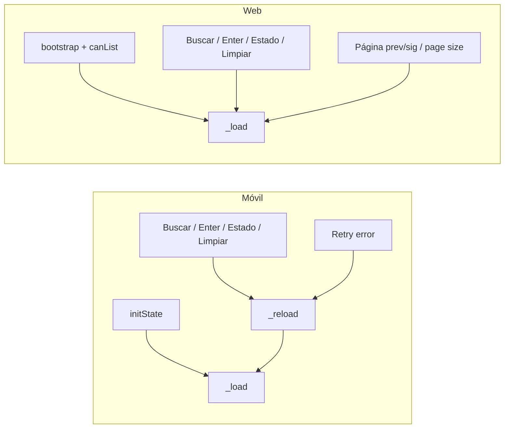

# Módulo Flutter — Evento masivo (`massiveEvent`)

Feature compartido (web y móvil): creación y gestión de **eventos masivos** y **simple events**, listado autónomo del módulo (excluye masivos ligados a recepción de compra en servidor), sincronización offline y pantallas de detalle/edición.

Documentación de producto: [`finca_app_docs/user_histories/uh-evento-masivo-lista.md`](../../../../../../finca_app_docs/user_histories/uh-evento-masivo-lista.md), [`finca_app_docs/mejoras/mejora-evento-masivo-lista.md`](../../../../../../finca_app_docs/mejoras/mejora-evento-masivo-lista.md), validación/edición/analíticas: [`finca_app_docs/user_histories/uh-evento-masivo-validacion-edicion-analiticas.md`](../../../../../../finca_app_docs/user_histories/uh-evento-masivo-validacion-edicion-analiticas.md), [`finca_app_docs/mejoras/mejora-evento-masivo-validacion-edicion-analiticas.md`](../../../../../../finca_app_docs/mejoras/mejora-evento-masivo-validacion-edicion-analiticas.md).

---

## Creación y edición (misma pantalla)

- **Ruta creación:** `/massive-events/create` (permiso bitmask **create**, índice 0).
- **Ruta edición / continuar sesión:** `/massive-events/edit?id=<uuid_del_masivo>` (permiso bitmask **update**, índice 2 en `massive_events`). El router pasa `initialMassiveEventId` a `MassiveEventPage`, que llama a `IMassiveEventPageDataSource.loadMassiveEventSession`.
- **Lista:** botón **Editar** en web y móvil solo si `massiveEventsBitmaskAllowsUpdate` y el evento está `open`.
- **Cerrado (`status == closed`):** la pantalla carga en solo lectura (`AbsorbPointer` + mensajes i18n).
- **Backend:** `GET /massive-events/:id/applied-animals` (declarado antes de `GET /massive-events/:id` en el controlador). Ver [`finca_app_docs/features/04-massive-events-module.md`](../../../../../../finca_app_docs/features/04-massive-events-module.md).

---

## Estructura

| Ruta                                          | Rol                                                                                                                                                                                                                                                                                                                                                                                                                         |
| --------------------------------------------- | --------------------------------------------------------------------------------------------------------------------------------------------------------------------------------------------------------------------------------------------------------------------------------------------------------------------------------------------------------------------------------------------------------------------------- |
| `pages/massive_event_list_page.dart`          | Entrada **lista** `/massive-events`: router (`kIsWeb` → web / móvil) + `export` de typedefs en `massive_event_list_types.dart`.                                                                                                                                                                                                                                                                                             |
| `pages/massive_event_list_web_page.dart`      | Lista **web**: tabla, filtros, paginación servidor.                                                                                                                                                                                                                                                                                                                                                                         |
| `pages/massive_event_list_mobile_page.dart`   | Lista **móvil**: `FutureBuilder`, filtros, filas.                                                                                                                                                                                                                                                                                                                                                                           |
| `pages/massive_event_list_permissions.dart`   | `massiveEventListResolvePermissions`: delega en `SessionService` o en override (D3 / fase 7).                                                                                                                                                                                                                                                                                                                               |
| `pages/massive_event_list_types.dart`         | Typedefs `MassiveEventsStandalonePagedFetch`, `MassiveEventsGetPermissions` (tests / inyección).                                                                                                                                                                                                                                                                                                                            |
| `pages/massive_event_list_client_filter.dart` | Filtro en cliente cuando hay `fetchStandaloneOverride` (misma semántica que API).                                                                                                                                                                                                                                                                                                                                           |
| `pages/massive_event_page.dart`               | Pantalla unificada creación / edición (`initialMassiveEventId`); validación previa al cierre; resumen de pesos de sesión.                                                                                                                                                                                                                                                                                                                                                                   |
| `pages/massive_event_sync_listener*.dart`     | Hooks de sincronización según plataforma.                                                                                                                                                                                                                                                                                                                                                                                   |
| `services/massive_event_api_service.dart`     | Cliente HTTP hacia `massive-events` (crear, cerrar, listado paginado, etc.).                                                                                                                                                                                                                                                                                                                                                |
| `models/`                                     | `MassiveEventModel` (incluye `linkedToPurchaseReception`, `createdByUsername`), `SimpleEventModel`, `AnimalSimpleEventModel`, tipos.                                                                                                                                                                                                                                                                                        |
| `domain/`                                     | Reglas puras: `massive_event_close_validation.dart`, `massive_event_close_failure_mapper.dart`, `massive_event_session_load.dart`, `massive_event_weight_stats.dart`.                                                                                                                                                                                                                                                                                              |
| `bloc/`                                       | `MassiveEventBloc` y estados/eventos de la pantalla de evento.                                                                                                                                                                                                                                                                                                                                                              |
| `widgets/`                                    | Formularios de evento, tabla de animales, paneles de configuración, **lista autónoma**: `massive_event_standalone_list_shared_views.dart` (D7: vacío / sin list / error genérico), `MassiveEventStandaloneListMobileFiltersCard`, `MassiveEventStandaloneListWebFiltersBar`, `MassiveEventStandaloneListMobileEventRow`, `MassiveEventListDateFilterField`, `MassiveEventListStatusChip` (callbacks; sin `SessionService`). |
| `data/massive_event_page_data_source*.dart`   | Abstracción de persistencia/API por plataforma (móvil vs web).                                                                                                                                                                                                                                                                                                                                                              |

Los data sources concretos viven bajo `lib/modules/mobile/data/massive_event/` y `lib/modules/web/data/massive_event/` (no en esta carpeta).

---

## API HTTP (`MassiveEventApiService`)

Base path: `{apiBaseUrl}/massive-events` (y otros recursos como `simple-events`, `cattle/apply-events` según método).

| Método estático                    | Uso                                                                                                                                                                                                               |
| ---------------------------------- | ----------------------------------------------------------------------------------------------------------------------------------------------------------------------------------------------------------------- |
| `createMassiveEvent`               | `POST /massive-events` — creación inicial con `simpleEvents`.                                                                                                                                                     |
| `listStandaloneMassiveEventsPaged` | `GET /massive-events` con query `page`, `limit`, `from`, `to`, `name`, `status`. Respuesta **`PagedResponseDto`**: `items`, `page`, `limit`, `total`, `hasMore`. Devuelve `MassiveEventsPageResult`.              |
| `listStandaloneMassiveEvents`      | Concatena páginas con `limit=500` hasta `hasMore == false` (tope de páginas de seguridad). Acepta los mismos filtros opcionales `from` / `to` / `name` / `status` en **cada** petición (alineado con el backend). |
| `closeMassiveEvent`                | `PUT /massive-events/close/:id` — 204 esperado.                                                                                                                                                                   |
| `getMassiveEventById`              | `GET /massive-events/:id` — detalle masivo (edición / metadatos).                                                                                                                                                  |
| `getAppliedAnimalsSession`         | `GET /massive-events/:id/applied-animals` — rehidratación de filas procesadas + `previousWeight` (último `cattle_weight_history` ajeno al masivo actual).                                                                          |
| `createSimpleEvent`                | `POST /simple-events`                                                                                                                                                                                             |
| `saveAnimalSimpleEvents`           | `POST /cattle/apply-events/:cattleNumber`                                                                                                                                                                         |
| `updateSimpleEvent`                | `PUT` genérico según `endpoint`                                                                                                                                                                                   |

Errores de red hacia el listado: `ApiException` con `serverConnectionError` / `readingObjectError`. Cuerpo de listado que no sea un objeto JSON map → `readingObjectError`.

---

## Lista (`MassiveEventListPage`)

- **Rutas:** típicamente `/massive-events` (stack completo) y panel embebido desde home con `embedded: true`.
- **Permisos:** bitmask entidad `massive_events` bajo módulo `MASSIVE_EVENTS`; helpers en `route_access.dart` (`massiveEventsBitmaskAllowsList`, `massiveEventsBitmaskAllowsCreate`, **`massiveEventsBitmaskAllowsUpdate`** para lista Editar + `/massive-events/edit`). Lectura vía `massiveEventListResolvePermissions` (`SessionService` por defecto; `getPermissionsOverride` en `MassiveEventListPage` para tests o DI explícita).

### Lista autónoma — cuándo se recarga (D6)

Referencia rápida para onboarding y revisiones de UX. Los métodos citados están en `massive_event_list_mobile_page.dart` y `massive_event_list_web_page.dart`.

#### Móvil

| Disparador                                                                 | Efecto                                                                                                           |
| -------------------------------------------------------------------------- | ---------------------------------------------------------------------------------------------------------------- |
| `initState`                                                                | Primera asignación a `_future = _load()` (permisos + `listStandaloneMassiveEvents` o `fetchStandaloneOverride`). |
| **Buscar** (`MassiveEventStandaloneListMobileFiltersCard` → `onSearch`)    | `_reload()` → nuevo `_load()`.                                                                                   |
| **Enter** en nombre/ID (`onNameSubmitted`)                                 | `_reload()`.                                                                                                     |
| Cambio de **estado** en el desplegable (`onStatusChanged`)                 | `setState` del estado + `_reload()`.                                                                             |
| **Limpiar filtros** (`onClearFilters` en card / `_clearFilters` en página) | Reset de fechas, nombre y estado + `_reload()`.                                                                  |
| **Reintentar** en vista de error (`TextButton` en `_buildBody`)            | `_reload()`.                                                                                                     |

Cambiar solo **desde** / **hasta** en los date pickers **no** dispara petición hasta usar **Buscar** u otro disparador de la tabla.

`embedded: true` vs `FincaScaffold` solo cambia el cromo (FAB / panel); los disparadores de recarga son los mismos.

#### Web

| Disparador                                                                 | Efecto                                                         |
| -------------------------------------------------------------------------- | -------------------------------------------------------------- |
| Tras `_bootstrap` si `canList`                                             | Primera `_load()` (paginada o `fetchStandalonePagedOverride`). |
| **Buscar** (`MassiveEventStandaloneListWebFiltersBar` → `onSearchPressed`) | `_page = 1` + `_load()`.                                       |
| **Enter** en nombre/ID (`onNameSubmitted`)                                 | `_page = 1` + `_load()`.                                       |
| Cambio de **estado** (`onStatusChanged`)                                   | `_page = 1` + `_load()`.                                       |
| **Limpiar filtros** (`onClearFilters` / `_clearFilters`)                   | Reset filtros, `_page = 1` + `_load()`.                        |
| Cambio de **tamaño de página** (`DropdownButton` filas/página)             | `_page = 1` + `_load()`.                                       |
| **Anterior / siguiente** paginación                                        | `_page--` / `_page++` + `_load()`.                             |

Igual que en móvil, ajustar solo fechas en UI **no** llama al servidor hasta **Buscar** (o acciones que ya combinan reset de página + `_load`).

#### Diagrama (resumen)

### Web (`kIsWeb`)

- Patrón visual alineado con compras: `FincaScaffold`, `Card` de filtros, `DataTable`, `MessageBanner`, paginación inferior.
- **Paginación y filtros en servidor:** cada `_load` llama a `listStandaloneMassiveEventsPaged` con `page`, `limit`, fechas (`yyyy-MM-dd`), texto `name`, `status` (`all` \| `open` \| `closed`).
- Fechas en UI no disparan solas la petición (como compras): **Actualizar**, cambio de **estado**, **Enter** en búsqueda, cambio de tamaño de página o flechas anterior/siguiente.
- Columnas: fecha evento, nombre o id, actualizado, estado (chip), **creado por** (prioriza `createdByUsername` del API), creado, columna sync “Servidor”.

### Móvil (`!kIsWeb`)

- Lista tipo `ListTile` con la misma información relevante que la tabla web; **filtros** equivalentes (fechas, nombre/id, estado) y acciones **Aplicar filtros** / **Limpiar** según implementación actual.
- Carga vía `listStandaloneMassiveEvents(...)` con filtros en query; si hay `fetchStandaloneOverride` en tests, los filtros se aplican en cliente con `filterStandaloneMassiveEventsClient` (misma semántica que el API).

### Tests

- `fetchStandaloneOverride`: solo **móvil** — devuelve `Future<List<MassiveEventModel>>`.
- `fetchStandalonePagedOverride`: solo **web** — misma firma que `listStandaloneMassiveEventsPaged` agregada al typedef `MassiveEventsStandalonePagedFetch`.
- `getPermissionsOverride` (**fase 7 / D3**): móvil y web — misma firma que `SessionService.getPermissions` (`MassiveEventsGetPermissions`); permite tests sin `saveSession` y futura inyección sin `InheritedWidget` ad-hoc en este feature.

---

## Modelo `MassiveEventModel`

- `linkedToPurchaseReception`: sincronizado con backend/Drift para excluir recepciones donde corresponda.
- `createdByUsername`: opcional; lo rellena el API en listados y detalle para mostrar usuario legible (el campo `createdBy` sigue siendo uuid).

---

## Pruebas automatizadas (referencia)

- `test/modules/shared/features/massiveEvent/domain/massive_event_close_validation_test.dart`
- `test/modules/shared/features/massiveEvent/domain/massive_event_close_failure_mapper_test.dart`
- `test/modules/shared/features/massiveEvent/pages/massive_event_list_page_test.dart`
- `test/modules/shared/features/massiveEvent/pages/massive_event_list_router_test.dart`
- Integración: `test/integration/massive_events_list_main_app_test.dart`, `integration_test/all_integration_tests.dart` (suite dispositivo; incluye lista masivos + smoke app)

---

## Backend relacionado

[`finca_app_backend/src/modules/massive-events/README.md`](../../../../../../finca_app_backend/src/modules/massive-events/README.md).
